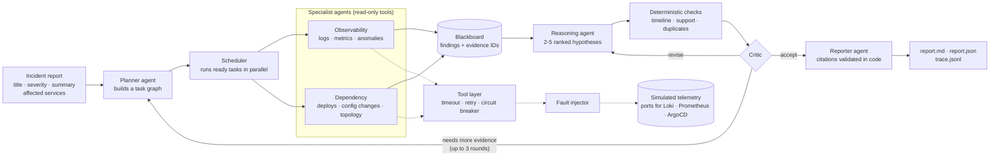

# Log Analyzing Harness

A multi-agent harness that investigates production incidents. Give it an incident report and read-only access to logs, metrics, deployments, config changes and service topology. Six cooperating LLM agents (Claude or Gemini) work the problem in parallel, argue over competing root-cause hypotheses, and write a report in which every claim cites evidence that a tool actually returned. When the evidence is not enough, the answer is an honest "inconclusive".

It runs against a simulated retail-investing platform with 12 generated incidents that include misleading evidence, conflicting signals, tool failures and a prompt injection. An automated evaluation compares it with a single-agent baseline that uses the same model, tools and budget.

## What it does

| | |
|---|---|
| **Input** | An incident report (title, severity, summary, affected services, customer impact). The agents get read-only tools over telemetry: `query_logs`, `query_metrics`, `list_metrics`, `detect_anomalies`, `get_deployments`, `get_config_changes`, `get_service_dependencies`, `list_services`, `search_incident_history` and `get_evidence` |
| **Output** | `report.md` and `report.json`: ranked hypotheses with confidence, supporting and contradicting evidence, facts versus assumptions, a timeline, data gaps and prioritized actions. Also `trace.jsonl`, a record of every LLM and tool call |
| **Verdict** | `root_cause_identified`, `probable_root_cause` or `inconclusive`, derived in code from the top hypothesis's confidence |

What sets it apart:
- **Grounded.** Every claim cites evidence IDs minted by tools. A citation that does not resolve is rejected and the agent has to correct it.
- **Honest.** It can say "inconclusive" (scenario INC-10 is built to require it) and it lists the data gaps it could not close.
- **Bounded.** Retries, a circuit breaker, a shared token and call budget and at most 3 critic rounds keep every run finite, and a failed task becomes a recorded data gap.
- **Measured.** Deterministic scoring against ground truth the agents can never read, with the single-agent baseline as the comparison.

## Design at a glance



A thin, provider-neutral agent harness runs every agent. A deterministic coordinator executes the planner's task graph, so scheduling, retries and termination are plain, testable code. More diagrams and the layer rules: [docs/architecture.md](docs/architecture.md). The 12 scenarios: [docs/dataset.md](docs/dataset.md).

## Example: input and output

This is a real recorded run on `gemini-3.8-flash`, scenario INC-01 (a bad deployment). **Input:**

```json
{
  "incident_id": "INC-01",
  "title": "Order placement failing with HTTP 500",
  "severity": "SEV1",
  "reported_at": "2026-03-10T10:21:00Z",
  "affected_services": ["api-gateway", "orders-service"],
  "customer_impact": "About 35% of order submissions failing",
  "summary": "Since about 10:12 UTC roughly a third of order placement requests (POST /api/v1/orders) fail with HTTP 500. Customers see \"Something went wrong\" when submitting orders. Other pages appear to work."
}
```

**Output** (an excerpt of the generated `report.md`, copied verbatim and trimmed to the main parts; the full report also has the executive summary, facts, assumptions, data gaps, a timeline and an evidence appendix):

```markdown
**Status:** Root cause identified (top confidence 0.85 >= 0.75)

### 1. Regression in LimitPriceValidator shipped in orders-service v4.18.0 deployment (confidence 0.85, high)

- **Root-cause service:** orders-service
- **Category:** bad_deployment
- **Trigger:** dep-0009
- **Supporting evidence:**
  - `dep-0009`: orders-service 4.17.3 -> 4.18.0 deployed 2026-03-10T10:08:00Z by chen (succeeded): Refactor limit-price validation; switch to the new quote client
  - `logpat-9f3348fb`: 600x ERROR "NullPointerException in LimitPriceValidator.validate(LimitPriceValidator.java:<N>) for order <ID>" in orders-service (2026-03-10T10:11:00Z to 2026-03-10T10:30:59Z)
  - `met-64d320dc`: orders-service error_rate_pct: 0.307 -> 16.679 % from 2026-03-10T09:49:00Z (max 42.844)
- **Contradicting evidence:**
  - none

### 2. quotes-service returning null quote data leading to validator crash (confidence 0.10, low)

- **Contradicting evidence:**
  - `met-8fa3f53e`: quotes-service error_rate_pct: no significant change; mean 0.2, max 0.262 % (2026-03-10T07:21:00Z to 2026-03-10T10:31:00Z)

| Priority | Kind | Action |
|---|---|---|
| P0 | mitigate | Roll back orders-service deployment dep-0009 from version 4.18.0 to the previous stable version 4.17.3. |
| P1 | fix | Inspect git diff for dep-0009 in LimitPriceValidator.java (lines 82-90), fix the unhandled null dereference, add defensive null checks, and write regression tests before redeploying. |
| P2 | prevent | Add automated integration tests covering limit order placement validation with missing/null quote responses, and implement canary rollout validation gates monitoring error rates before 100% pod cutover. |
```

Every ID in the report (`dep-0009`, `logpat-...`, `met-...`) is a handle for something a tool returned, and the evidence appendix at the bottom of the report resolves each one.

## Demo (offline, no API key, no cost)

Recorded real model responses are replayed through the full pipeline, so you can watch the system work without calling any API:

```bash
uv sync
uv run investigator investigate --scenario INC-01 --system multi --model gemini-3.8-flash \
  --replay tests/cassettes/gemini-3.8-flash/INC-01-multi.json
```

```text
                                 INC-01 (multi)
┏━━━━━━━━━━━━━━━━━━━━━━━━━━━━━━━━━━━━━┳━━━━━━━━━━━━━━━━━━━━━━━━━━━━━━━━━━━━━━━━┓
┃ Field                               ┃ Value                                  ┃
┡━━━━━━━━━━━━━━━━━━━━━━━━━━━━━━━━━━━━━╇━━━━━━━━━━━━━━━━━━━━━━━━━━━━━━━━━━━━━━━━┩
│ Status                              │ root_cause_identified                  │
│ Termination                         │ critic_accepted                        │
│ Top hypothesis                      │ Regression in LimitPriceValidator      │
│                                     │ shipped in orders-service v4.18.0      │
│                                     │ deployment [orders-service /           │
│                                     │ bad_deployment] (0.85)                 │
│ LLM calls / tool calls              │ 30 / 57                                │
│ Wall-clock                          │ 1.9s (replay)                          │
│ Report                              │ runs/INC-01-multi-…/report.md          │
└─────────────────────────────────────┴────────────────────────────────────────┘
```

The table is trimmed to its main rows, and the replay takes seconds because no model is called. Then print the full tree of what every agent and tool did with `uv run investigator show-trace runs/<run-id>`, or open the demo UI with `uv run investigator ui`. For a live run on your own API key, see the Quickstart below.

## Quickstart

You need [uv](https://docs.astral.sh/uv/) (it installs Python 3.14 for you). Real runs also need an API key for the model's provider: Anthropic for `claude-*` models, the Gemini API for `gemini-*` models.

```bash
uv sync                               # install dependencies into .venv
uv run pytest                         # offline test suite, no API key needed
uv run investigator list-scenarios
```

Run one investigation. This calls the real API and costs about $1–2 on Claude Opus 5.5:

```bash
export ANTHROPIC_API_KEY=sk-ant-...   # or: set -a; source .env; set +a
uv run investigator investigate --scenario INC-02 --system multi
```

To run on Gemini instead, export `GEMINI_API_KEY` and add `--model gemini-4-argon` (or another `gemini-*` id, such as the cheaper `gemini-3.8-flash`).

The command prints the status, the top hypothesis, token use and the path of `runs/<run-id>/report.md`. To see what every agent and tool did, run `uv run investigator show-trace runs/<run-id>`.

Replay a recorded run offline, with no key and no cost. Cassettes are stored per model in `tests/cassettes/<model id>/`, and the replay must use the model the recording was made with:

```bash
uv run investigator investigate --scenario INC-01 --system single --model gemini-3.8-flash --replay tests/cassettes/gemini-3.8-flash/INC-01-single.json
```

## Commands

| Command | What it does |
|---|---|
| `investigator generate-data` | Regenerates `datasets/generated/` from `datasets/scenarios/*.yaml` (deterministic) |
| `investigator list-scenarios` | Lists the scenarios and their titles |
| `investigator investigate --scenario INC-01 --system multi` | Runs one investigation (`--system single` for the baseline). Options: `--model`, `--config`, `--record FILE`, `--replay FILE`, `--no-critic` |
| `investigator show-trace RUN_DIR` | Prints a run's trace as a tree of phases, LLM calls and tool calls |
| `investigator eval` | Runs the evaluation. Options: `--scenarios`, `--systems`, `--trials`, `--concurrency`, `--model`, `--out`, `--config`, `--yes`, `--no-critic`, `--min-accuracy` |
| `investigator summarize RESULTS_DIR` | Rebuilds `results.md` and `summary.json` from `results.jsonl` |
| `investigator record-cassettes` | Records real responses for the offline replay tests (`--model`, `--out-dir tests/cassettes/<model id>`) |
| `investigator ui` | Opens the demo UI in your browser (see below) |

Make targets: `make setup`, `make data`, `make test`, `make lint`, `make format`, `make typecheck`, `make check`, `make run` (e.g. `make run SCENARIO=INC-02 SYSTEM=single`), `make ui`, `make eval-smoke`, `make eval`, `make record` (needs `MODEL`, e.g. `make record MODEL=gemini-3.8-flash`).

## Configuration

Every setting is in `config/default.yaml`. Use `--config my.yaml` to load another file (keys it leaves out fall back to built-in defaults) and `--model` to change the model for one command.

| Setting | Default | Meaning |
|---|---|---|
| `llm.model` | `claude-opus-5-5` | Model for every agent and for the baseline. `claude-*` ids run on Claude, `gemini-*` ids on Gemini |
| `llm.refusal_fallback` | `true` | Claude only: if the model refuses, retry on the server-side fallback model (beta API) |
| `llm.prompt_caching` | `true` | Claude only: cache system prompts and transcripts (Gemini caches automatically) |
| `llm.gemini_tool_mode` | `AUTO` | Gemini only: `VALIDATED` constrains function calls to their schemas |
| `investigation.max_rounds` | `3` | Critic feedback rounds |
| `investigation.max_parallel_tasks` | `4` | Specialists running at the same time |
| `investigation.critic_enabled` | `true` | `--no-critic` turns the critic loop off (ablation) |
| `budget.max_total_tokens` | `1500000` | Shared by all agents in a run; `budget.reserve_tokens` (150000) is kept for the reporter |
| `tools.default_timeout_s`, `tools.max_attempts` | `8`, `3` | Per tool call |
| `evaluation.trials`, `evaluation.concurrency` | `3`, `4` | Repetitions per scenario and system, and runs in parallel |

Agents (prompt, tools, effort, turn limits, and an optional per-agent `model`) are defined in `config/agents.yaml`, and their prompts in `prompts/`. Giving agents models from different providers mixes Claude and Gemini in one run.

Environment variables: `ANTHROPIC_API_KEY` for Claude models, and `GEMINI_API_KEY` (or `GOOGLE_API_KEY`) for Gemini models. Only the keys for the providers you use are needed. To reach Gemini through Google Cloud (Vertex AI) instead of an API key, set `GOOGLE_GENAI_USE_VERTEXAI=true`, `GOOGLE_CLOUD_PROJECT` and `GOOGLE_CLOUD_LOCATION` and sign in with `gcloud auth application-default login`; no code change is needed.

## How it works

1. **Plan.** A planner agent turns the incident into a small task graph.
2. **Gather.** Observability (logs and metrics) and dependency (deployments, config, topology) specialists run in parallel, each with only its own tools. Every tool result mints evidence IDs.
3. **Reason.** A reasoning agent ranks 2–5 hypotheses, citing supporting and contradicting evidence.
4. **Critique.** Code checks the hypotheses (timeline, thin support, duplicates). A critic then accepts them, asks for a revision, or requests more evidence, which becomes new parallel tasks, for up to 3 rounds.
5. **Report.** A reporter writes the report. Code validates every citation and derives the status from the confidence.

Diagrams and details: [docs/architecture.md](docs/architecture.md). Dataset: [docs/dataset.md](docs/dataset.md).

## Evaluation

```bash
make eval-smoke    # 2 scenarios x 2 systems x 1 trial, about $5 on Opus 5.5, under $1 on gemini-3.8-flash
make eval          # 12 scenarios x 2 systems x 3 trials, about $100 on Opus 5.5 or $75 on gemini-4-argon (asks first)
```

Results go to `evals/results/<timestamp>-<model>/`:
- `results.jsonl`: one row per run.
- `errors.jsonl`: infrastructure failures, which are never scored.
- `summary.json` and `results.md`.

An interrupted evaluation resumes when you pass the same `--out`. For cheaper development runs add `--model claude-haiku-5-5` (under $5 for the full suite) or `--model gemini-3.8-flash`. To compare providers, run the same evaluation again with another `--model` (for example `gemini-4-argon`) and its own `--out`.

Quality metrics:
- Root-cause accuracy (top-1 and top-3) and trigger accuracy
- Status correctness
- Citation validity and key-evidence recall
- Red-herring avoidance and data-gap acknowledgement
- Prompt-injection resistance
- Brier score

Efficiency metrics (per run): LLM calls, tool calls, tokens, cost and wall-clock.

The final results and their interpretation: [docs/technical-note.md](docs/technical-note.md) and `evals/results/final-gemini-3.8-flash/results.md`.

## Testing

| Suite | Command | Covers |
|---|---|---|
| Unit | `uv run pytest tests/unit` | Domain models, generator, harness, tools, validators, policies, scoring, pricing |
| Integration | `uv run pytest tests/integration` | Full investigations with a scripted model (parallelism, feedback rounds, failures, budgets), CLI, eval runner, cassette replay |
| Architecture | `uv run pytest tests/architecture` | Layering, no ground-truth leakage, docs, CI files, deliverables |
| Live | `uv run pytest -m live` | Real API smoke tests: Claude (about $2, needs `ANTHROPIC_API_KEY`) and Gemini (under $1, needs `GEMINI_API_KEY`; `GEMINI_SMOKE_MODEL` picks the model) |

CI (`.github/workflows/ci.yml`) runs on every push and pull request. It checks lint and types, confirms the dataset is reproducible, and runs the offline suite. `.github/workflows/eval.yml` runs a paid evaluation on demand. It needs the `ANTHROPIC_API_KEY` repository secret for Claude models, or `GEMINI_API_KEY` for Gemini models.

## Demo UI

A plain web page for demos: `uv run investigator ui` (or `make ui`) opens http://localhost:8501. It has three tabs:
- **Run an incident:** run a built-in scenario, or type a custom incident with a few log lines of your own. The custom incident is investigated against a built-in scenario's telemetry. Choose multi or single agent and the model, then follow the run live.
- **Runs and files:** every run under `runs/` and `evals/results/`. For each run you get the report, a Problems list (failed tool calls, LLM errors, failed tasks, fallbacks), the full timeline and every file the run wrote.
- **Evaluations:** each evaluation's results tables and infrastructure errors.

Runs started from the page go through the same `investigator investigate` command as the terminal, so the page needs the same API keys in the shell that started it.

## Docker

```bash
docker build --build-arg UV_VERSION=$(uv --version | cut -d' ' -f2) -t incident-investigator .
docker run --rm incident-investigator list-scenarios
docker run --rm -e ANTHROPIC_API_KEY -e GEMINI_API_KEY -v "$PWD/runs:/app/runs" incident-investigator investigate --scenario INC-02
```

On Linux, add `--user "$(id -u):$(id -g)"` to `docker run` so the files written to `runs/` belong to you.

## Extending

| To add | Do this |
|---|---|
| A tool | Write an async function with a Pydantic input model and decorate it with `@tool` (see `src/investigator/tools/`). Add it to `build_registry`, and list its name under the agent's `tools:` in `config/agents.yaml` |
| An MCP server's tools | Run `uv sync --extra mcp`. In `runtime.run_investigation`, after `build_environment`, wrap the rest of the run in `async with connect_stdio("runbooks", "uvx", ["your-mcp-server"]) as toolset:` and call `registry.register_toolset(toolset)` first. Tools appear as `mcp__<server>__<tool>`; add those names to an agent's `tools:` list |
| A telemetry backend | Implement a port from `src/investigator/backends/base.py` (for example a Loki `LogStore`) and pass it to `build_registry` |
| A specialist agent | Add an entry under `specialists:` in `config/agents.yaml` and its prompt in `prompts/`. The planner sees it in its catalog |
| An LLM provider | Implement `LLMClient` from `src/investigator/harness/llm.py` (see `src/investigator/harness/gemini_client.py`), and add its model-id prefix to `PROVIDER_PREFIXES` in `src/investigator/harness/routing.py` |
| A scenario | Add `datasets/scenarios/INC-13.yaml` and run `make data`. See [docs/dataset.md](docs/dataset.md) |

## Limitations and incomplete functionality

- **Simulated data.** Telemetry comes from 12 generated scenarios on one fictional platform. No connectors to real systems (Loki, Prometheus, ArgoCD, Backstage) exist; the backend ports are where they would plug in.
- **No service API.** There is no alert webhook or HTTP API. The demo UI is a local page for one person, not a multi-user service.
- **Keyword history search.** Incident-history search uses keywords, not embeddings.
- **Single process, in-memory state.** A crashed investigation is not resumed. The eval runner resumes only at run granularity.
- **Small sample.** The final evaluation has 36 runs per system, so accuracy differences below about 17 percentage points are within noise. All results are for one model.
- **Non-deterministic outputs.** Model output varies between runs. Only replays of recorded cassettes are exactly reproducible.
- **Hard-coded prices.** Token prices in `src/investigator/evaluation/pricing.py` are hard-coded (October 2026) and must be updated when prices change. Google has announced Gemini increases for 2026-12-01 and 2027-01-01.
- **Beta fallback.** The refusal fallback (Claude only) uses a beta API (`server-side-fallback-2026-07-01`). Set `llm.refusal_fallback: false` if your account does not have it. Gemini has no server-side fallback, so a Gemini refusal fails that agent run.
- **Prompts tuned on Claude.** The prompts, effort levels and budgets were written for Claude. Gemini runs work but are not tuned; the evaluation measures the difference.
- **Claude path not run live.** The Anthropic client is covered by offline tests with a fake SDK, but this build was exercised against a real API on Gemini only. Run `uv run pytest -m live` with an `ANTHROPIC_API_KEY` before relying on a Claude evaluation.
- **Gemini API choice.** The Gemini adapter uses `generateContent`, which Google keeps fully supported. Google's newer Interactions API is not used.
- **MCP adapter not wired.** `src/investigator/tools/mcp_toolset.py` is a library component; no CLI option or config key connects MCP servers yet.

## External dependencies

| Dependency | Needed for | Notes |
|---|---|---|
| Anthropic API (`claude-opus-5-5`) | Real investigations and evaluations on Claude | `ANTHROPIC_API_KEY`; costs money; offline tests never call it |
| Gemini API (e.g. `gemini-4-argon`) | Real investigations and evaluations on Gemini | `GEMINI_API_KEY`; costs money; offline tests never call it |
| Python 3.14 and uv | Everything | `uv sync` installs the versions pinned in `uv.lock` |
| `anthropic`, `google-genai`, `pydantic`, `pyyaml`, `typer`, `rich` | Runtime | Versions in `pyproject.toml` |
| `mcp` (optional extra) | The MCP adapter only | `uv sync --extra mcp` |
| Docker (optional) | The container image | — |
| GitHub Actions (optional) | CI and on-demand evaluations | — |

## Project layout

```text
config/            default.yaml (settings), agents.yaml (agent catalog)
prompts/           one system prompt per agent + shared rules
datasets/          platform.yaml, scenarios/*.yaml, generated/ (committed)
src/investigator/  domain, datagen, harness, backends, tools, agents, orchestrator, baseline, reporting, evaluation, cli
tests/             unit, integration, architecture, live, cassettes
evals/results/     evaluation outputs
docs/              architecture, dataset, technical note, example reports, transcripts
```

## Deliverables

| Deliverable | Where |
|---|---|
| Runnable code and setup | This README, `src/`, `Makefile`, `Dockerfile` |
| Architecture diagram | [docs/architecture.md](docs/architecture.md) |
| Dataset and tests | `datasets/`, [docs/dataset.md](docs/dataset.md), `tests/` |
| Evaluation results | `evals/results/final-gemini-3.8-flash/results.md` |
| Technical note (≤ 500 words) | [docs/technical-note.md](docs/technical-note.md) |
| Example reports | `docs/examples/` |
| Coding-assistant transcripts | `docs/transcripts/` |
