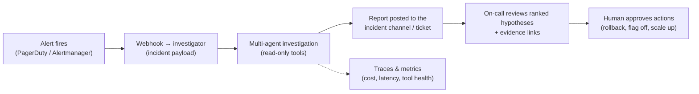
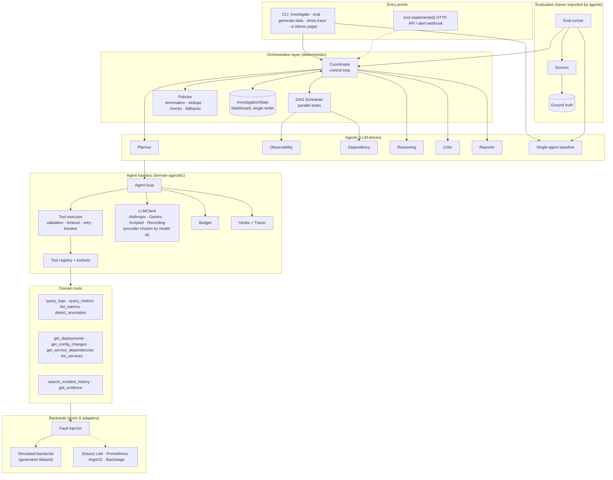
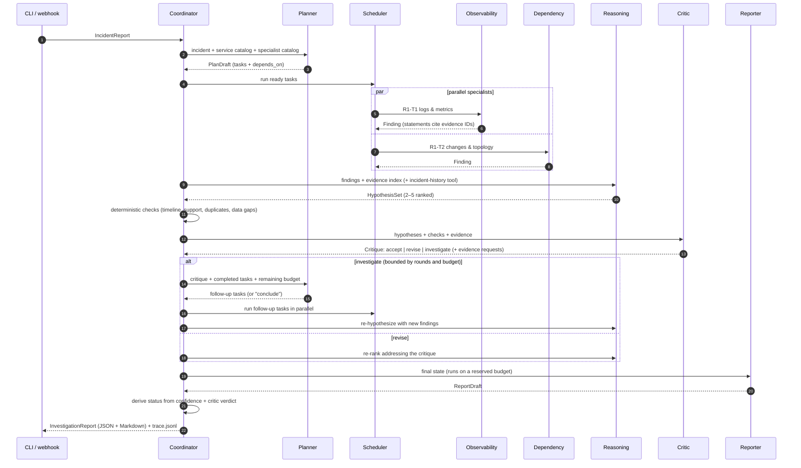

# Architecture

The investigator is one Python package, `src/investigator/`. A thin, provider-neutral agent harness runs every agent. A deterministic coordinator executes an LLM planner's task graph in parallel over a shared blackboard. A critic drives bounded feedback rounds, and a reporter writes the final report. Tools read simulated telemetry through a fault injector. An evaluation harness compares the system with a single-agent baseline that has the same model, tools and budget.

## 1. Where it sits in production

The system is an investigator, not an actor. Every tool is read-only, and a human approves every action. In this repository the CLI replaces the alert webhook, and a simulated platform replaces the telemetry backends (see `docs/dataset.md`).

## 2. Layers

Each layer depends only on the layers below it:
- The harness knows nothing about incidents.
- Tools know nothing about agents.
- Backends know nothing about faults; the injector wraps them.
- Evaluation can read everything, but nothing imports it. `tests/architecture/test_boundaries.py` enforces this.

| Package | Responsibility |
|---|---|
| `investigator.domain` | Pydantic models: incident, evidence, findings, hypotheses, critique, plan, report, state |
| `investigator.harness` | LLM clients, tool protocol, registry and executor, agent loop, budget, hooks, tracing, retry and circuit breaker |
| `investigator.backends` | Ports (protocols and records), simulated implementation, fault injector, analysis helpers |
| `investigator.tools` | The 10 domain tools: thin wrappers over backends that mint evidence |
| `investigator.agents` | Agent catalog (YAML), submit tools and validators, context builders |
| `investigator.orchestrator` | Coordinator, scheduler, policies (termination, checks, fallbacks) |
| `investigator.baseline` | Single-agent investigator |
| `investigator.reporting` | Markdown report rendering |
| `investigator.datagen` | Scenario models and the deterministic generator |
| `investigator.evaluation` | Ground truth, scorers, pricing, runner, summary |
| `investigator.cli` | Typer commands |

## 3. One investigation, end to end

## 4. Coordinator state machine

```mermaid
stateDiagram-v2
  [*] --> Planning
  Planning --> Gathering: plan accepted (or deterministic fallback plan)
  Gathering --> Hypothesizing: no runnable tasks left
  Hypothesizing --> Critiquing: hypotheses accepted
  Hypothesizing --> Reporting: reasoning failed twice
  Critiquing --> Reporting: accept / max rounds / budget / stagnation / critic failed
  Critiquing --> Hypothesizing: revise
  Critiquing --> Replanning: investigate
  Replanning --> Gathering: new (deduplicated) tasks
  Replanning --> Reporting: planner concludes / nothing new to run
  Reporting --> [*]
```

Every run records one termination reason: `critic_accepted`, `max_rounds_reached`, `budget_exhausted`, `stagnated`, `planner_concluded`, `no_new_tasks`, `critic_failed` or `reasoning_failed`.

## 5. Agents

Every agent, including the baseline, is configuration on one harness class: a prompt (`prompts/<name>.md`), a least-privilege tool list, an output type that defines its submit tool, an effort level and turn limits (`config/agents.yaml`). An agent ends only by calling its submit tool with output that passes schema and citation validation. It never writes shared state; the coordinator merges its output.

The model id decides the provider: `claude-*` ids run on the Anthropic client and `gemini-*` ids on the Gemini client (`harness/routing.py` creates each client on first use). The CLI's `--model` sets the model for every agent at once; a `model:` entry in `config/agents.yaml` sets it for one agent, so one run can mix providers.

| Agent | Role | Tools | Output | Effort |
|---|---|---|---|---|
| Planner | Turns the incident into 2–6 tasks with dependencies; later turns critic requests into follow-up tasks or concludes | none | `submit_plan` | medium |
| Coordinator (code) | Owns the state, validates plans, schedules, enforces limits, runs deterministic checks, derives the status | — | — | — |
| Observability | Finds anomalies and their onset, separates causes from symptoms, reports data gaps | `detect_anomalies`, `list_metrics`, `query_metrics`, `query_logs` | `submit_findings` | medium |
| Dependency | Correlates deployments and config changes with the onset, walks the topology, rules out coincidental changes | `get_deployments`, `get_config_changes`, `get_service_dependencies`, `list_services` | `submit_findings` | medium |
| Reasoning | Builds 2–5 competing hypotheses with mechanisms, supporting and contradicting evidence, assumptions and calibrated confidence | `search_incident_history`, `get_evidence` | `submit_hypotheses` | high |
| Critic | Adversarial review: unsupported claims, timeline violations, ignored contradictions, overconfidence | `get_evidence` | `submit_critique` | medium |
| Reporter | Writes the final report from the record without adding new claims | `get_evidence` | `submit_report` | medium |
| Single-agent baseline | Does everything alone | all 10 data tools | `submit_report` | high |

How the agents collaborate (this is not prompt chaining):
1. **Dynamic planning.** The planner chooses which specialists run, on which services and windows, and in which order.
2. **Typed artifacts on a blackboard.** Findings, hypotheses and critiques are validated objects that cite evidence IDs; any agent can resolve a citation with `get_evidence`.
3. **Dependent tasks carry information.** A task that depends on another receives the upstream finding in its context.
4. **Specialist leads.** A specialist can suggest a check for another specialist; the planner can turn it into a task.
5. **Critic-driven loop.** `investigate` produces evidence requests that become new parallel tasks; `revise` sends reasoning flaws back without new data collection.
6. **Code informs the critic.** Deterministic checks flag a trigger that happened after the onset, high confidence on thin support, duplicates and data gaps, and the critic must address each flag.

## 6. Tools, evidence and grounding

| Tool | Reads | Evidence it mints |
|---|---|---|
| `query_logs` | `LogStore.search_logs` | `logpat-` log patterns, `log-` sample lines |
| `query_metrics` | `MetricStore.get_metric` | `met-` metric series (with change point) |
| `list_metrics` | `MetricStore.list_metrics` | none |
| `detect_anomalies` | `MetricStore`, every metric of the given services | `met-` series that changed |
| `get_deployments` | `ChangeStore.list_deployments` | `dep-` deployments |
| `get_config_changes` | `ChangeStore.list_config_changes` | `cfg-` config and feature-flag changes |
| `get_service_dependencies` | `TopologyStore.get_service` | `topo-` service dependency records |
| `list_services` | `TopologyStore.list_services` | none |
| `search_incident_history` | `IncidentArchive.search` | `hist-` past incidents |
| `get_evidence` | the run's evidence store | none (resolves IDs) |

Every tool call returns a JSON envelope. On success: `{"ok": true, "data": ..., "evidence_ids": [...], "partial": ..., "warnings": [...], "attempts": n}`. On failure: `{"ok": false, "error": {"type", "message", "retryable", "hint"}, "attempts": n}`. The executor never raises, so the model always sees what happened and can work around it.

Grounding rules:
- Every statement has a kind: `observation` (read directly from evidence; must cite IDs), `inference` or `assumption`. The report keeps facts (observations with citations) separate from assumptions.
- Submit tools reject any citation that is not in the run's evidence store, so fabricated evidence IDs cannot reach the report.
- Code derives the status: top confidence ≥ 0.75 gives `root_cause_identified` (only `probable_root_cause` if the critic did not accept), ≥ 0.50 gives `probable_root_cause`, and anything lower gives `inconclusive`.

## 7. Reliability

| Limit | Default | Enforced by |
|---|---|---|
| Rounds | 3 | Coordinator |
| Tasks total / follow-up tasks per round | 12 / 4 | Coordinator (plan validation and dedupe) |
| Parallel tasks | 4 | Scheduler |
| Task attempts / task timeout | 2 / 240 s | Scheduler |
| Agent turns / tool calls | per agent (e.g. observability 12 / 16, baseline 40 / 60) | Agent loop |
| Tool attempts / tool timeout | 3 / 8 s | Tool executor |
| Circuit breaker | opens after 4 failed calls per (tool, service) for 30 s | Tool executor |
| Global budget | 1.5M tokens, 120 LLM calls, 250 tool calls, 1800 s | `Budget`, shared by all agents |
| Reporter reserve | 150K tokens, 8 calls, 120 s held back so a report is always produced | `Budget` |

| Failure | Behavior |
|---|---|
| Tool timeout, 503 or 429 | Retry with jittered backoff (honoring `retry_after`), then an error envelope with a hint; the agent records a data gap |
| Partial or truncated data | Flags and missing ranges are passed to the agent with a warning |
| Invalid tool arguments | Error envelope listing the field errors; the model corrects itself |
| Agent never submits or keeps submitting invalid output | The task is retried once with the error in context, then recorded as a failed task and a data gap |
| Planner fails | Deterministic fallback plan |
| Reasoning fails twice | The loop stops; the report is built from the findings (usually inconclusive) |
| Critic fails | The loop stops; the status is capped at probable |
| Reporter fails twice | Deterministic fallback report, marked as such |
| Model refusal | Server-side fallback model; if that also refuses, the agent fails as above |
| Budget exhausted | The investigation stops and the reporter runs on its reserve |

## 8. Determinism and replay testing

- Datasets come from seeds; generating twice gives identical bytes.
- Tool results use sorted keys and contain no timings.
- Context builders sort findings, evidence and gaps, so parallel completion order never changes a prompt.
- Prompts contain no timestamps, UUIDs or run IDs.
- Fault counters are per caller, so they do not depend on interleaving.
- The evidence store merge is order-independent.

Together these make a recorded real-model run replay exactly offline (`tests/integration/test_replay.py`), so prompt or harness changes are caught without API calls.

## 9. Extension points

| To add | You touch | You do not touch |
|---|---|---|
| A native tool | One file in `src/investigator/tools/` (Pydantic input model, async function, `@tool`), one line in `build_registry`, the agent's `tools:` list in `config/agents.yaml` | Agent loop, coordinator, other tools |
| Tools from another source, such as an MCP server | A `Toolset` that wraps each external tool as a `Tool`, registered with `registry.register_toolset(...)`. Names must match `^[a-zA-Z0-9_-]{1,64}$`, e.g. `mcp__<server>__<tool>` | Agent loop, coordinator |
| A real telemetry backend | One adapter class implementing a port in `src/investigator/backends/base.py` (e.g. a Loki `LogStore`) | Tools, agents |
| A specialist agent | An entry under `specialists:` in `config/agents.yaml` and a prompt in `prompts/`; the planner sees it in its catalog | Coordinator, scheduler |
| A different LLM provider | An `LLMClient` implementation (like `harness/gemini_client.py`) and its model-id prefix in `PROVIDER_PREFIXES` (`harness/routing.py`). Claude and Gemini are built in | Agents, tools, orchestration |
| A test incident | A YAML file in `datasets/scenarios/`, then `make data` | Code |

## 10. Evaluation

The runner executes every scenario × system × trial, scores each report deterministically against the scenario's ground truth, and writes `results.jsonl`, `summary.json` and `results.md`. Quality metrics: root-cause accuracy (top-1 and top-3), trigger accuracy, status correctness, citation validity, key-evidence recall, red-herring avoidance, data-gap acknowledgement, prompt-injection resistance and Brier score. Efficiency metrics: LLM calls, tool calls and attempts, tokens by type, cost and wall-clock.

The baseline comparison is fair by construction: same model, same tools, backends and faults, same total budget, same report schema, status rule and scorer, and the baseline runs at the highest effort level any multi-agent component uses. Infrastructure failures go to `errors.jsonl` and are never scored as wrong answers.
