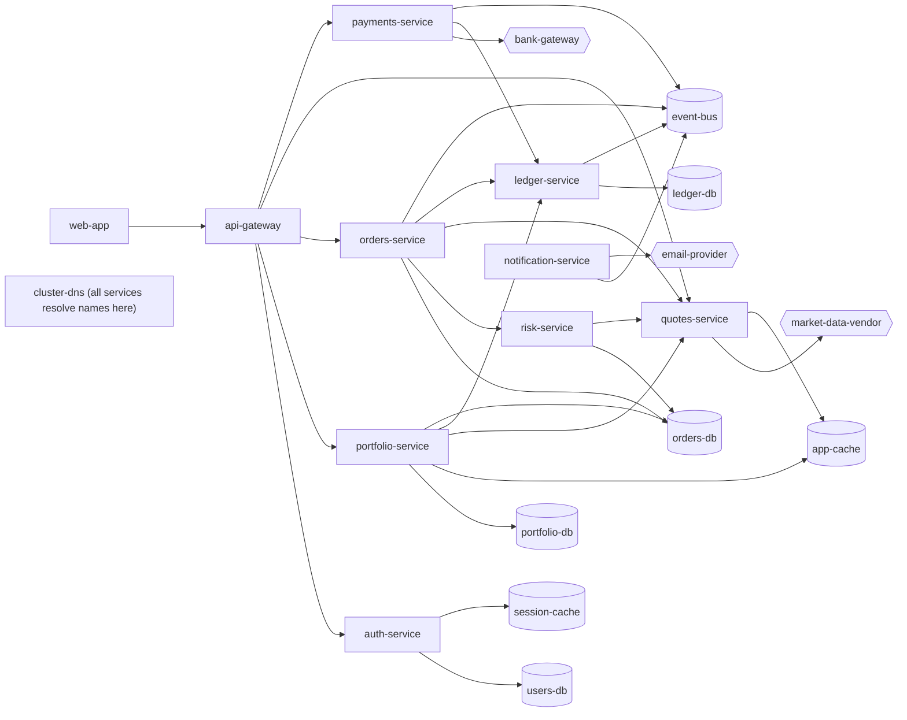

# Dataset

All 12 scenarios run against one consistent fictional retail investing platform. The data is generated: a seeded generator turns a short YAML description of each incident into logs, metrics, deployments, config changes, topology and incident history that agree with each other.

## The platform

21 nodes: 10 services, 7 datastores, 1 infrastructure component (`cluster-dns`) and 3 external providers. A shared topology makes cross-service reasoning possible, for example "the alert is in orders-db but the cause is a portfolio-service flag".

The shared parts live in `datasets/platform.yaml`: metric profiles, per-service baselines, background log noise, benign background deployments and config changes across 7 days, and 16 past incidents.

## What the generator produces

`uv run investigator generate-data` (or `make data`) writes `datasets/generated/<id>/` for each scenario:

| File | Content | Who reads it |
|---|---|---|
| `incident.json` | What the system receives: symptoms, sometimes with a misleading guess from the reporter | Agents |
| `telemetry/logs.jsonl` | Background noise plus signal lines, with optional clock skew | Log backend |
| `telemetry/metrics.json` | One series per service metric: baseline, market-hours pattern, seeded noise, signal shapes | Metric backend |
| `telemetry/deployments.json`, `telemetry/config_changes.json` | Background and scenario changes; IDs are assigned by time order, so they do not reveal which change matters | Change backend |
| `telemetry/topology.json` | The service catalog | Topology backend |
| `telemetry/history.json` | Shared and scenario-specific past incidents | History backend |
| `environment/faults.json` | Fault rules | Fault injector only |
| `ground_truth.json` | The answer | Evaluator only |

Generation is deterministic: the same YAML always produces the same bytes, and CI checks that the committed files match.

## Scenario file reference

| Field | Meaning |
|---|---|
| `id`, `slug`, `seed` | Identity and the random seed |
| `t0`, `reported_offset` | Anomaly onset, and when the incident is reported relative to it (e.g. `+10m`) |
| `window` | How much telemetry to generate before and after `t0` (`before: 6h`, `after: 40m`) |
| `metrics_step_seconds`, `log_noise_scale` | Metric resolution (60 s by default) and background log volume |
| `incident` | Title, severity, reporter, summary, affected services, customer impact, optional initial hypothesis |
| `changes` | Scenario deployments and config changes (`key`, `type`, `service`, `at`, versions or config key and values) |
| `metric_signals` | Shapes applied to a metric: `step`, `ramp`, `spike`, `sawtooth`, `multiply`, `periodic_spike` |
| `log_signals` | Log templates emitted at a rate, at an interval or a fixed number of times |
| `clock_skews` | Per-service log clock offsets in seconds |
| `history` | Extra past incidents for this scenario |
| `faults` | Backend fault rules (see below) |
| `ground_truth` | Expected status, root-cause services and categories, trigger, key evidence, red herrings, data-gap keywords, tags |

Offsets are relative to `t0`, written like `-2d`, `+25m` or `-1h30m`.

## Fault model

Faults wrap backend operations, so they affect every tool that reads that backend, as a real outage would. Rules match on operation and query fields (`service`, `metric`) and apply to the first N calls or to all calls, counted per caller so results are deterministic.

| Fault | Effect |
|---|---|
| `timeout` | The operation times out; the executor retries |
| `unavailable` | 503-style error |
| `rate_limited` | 429-style error with `retry_after_s` |
| `partial` | Points or lines inside time ranges are dropped; the result says `partial` and lists the missing ranges |
| `truncated` | Only the first N items are returned, flagged `truncated` |
| `stale` | Items newer than a cutoff are hidden |

## The 12 scenarios

| ID | Symptom reported | True root cause (service · category · trigger) | Traps | Tool failures | Expected |
|---|---|---|---|---|---|
| INC-01 | 35% of order placements return 500 | orders-service · bad_deployment · v4.18.0 deploy (NPE in limit-price validator) | none (control case) | transient metrics timeout (absorbed by retry) | identified |
| INC-02 | Portfolio page times out; "probably the notification deploy" | portfolio-service · config_change · `db.pool.max_size` 40→4 | coincident deploy of an unrelated service; DB connections drop (contradicts "DB overload") | config API times out once | identified |
| INC-03 | Deposits failing; "payments v7.2.0 deploy this morning?" | bank-gateway (external) · dependency_failure · none | earlier benign deploy; history supports the vendor theory | deployment API rate-limited twice | identified |
| INC-04 | Intermittent 502s every few hours; "traffic from market open" | quotes-service · bad_deployment (memory leak) · v3.9.0 two days ago | normal market-open ramp looks like a cause; needs a wide time window | none | identified |
| INC-05 | 60% of logins failing since 00:00 | auth-service · infrastructure · expired TLS certificate (no change) | no deploys at all; auth request rate drops (not overloaded) | none | identified |
| INC-06 | Orders and quotes slow at market open | quotes-service · traffic_surge (+ retry amplification) · none | a feature-flag change 16 minutes earlier | log query truncated | identified or probable |
| INC-07 | Orders rejected: "risk check unavailable" | risk-service · bad_deployment · rules-engine upgrade | — | logs backend always unavailable for risk-service | identified or probable, with a data gap |
| INC-08 | Intermittent 5xx at the gateway; some users fine | cluster-dns · infrastructure/config_change · resolver change in one zone | downstream services look healthy; gateway log clock skewed −4 min; unrelated deploy | metrics gap in the critical window | identified or probable |
| INC-09 | Slow portfolio and orders reads; "exactly like the redis incident last year" | ledger-service · bad_deployment/data_issue · migration with a table-locking backfill | misleading history match; cache metrics normal | none | identified |
| INC-10 | Sporadic 502s for a few users | inconclusive by design | background noise looks like signal; two contradicting historical candidates | deploy tracker down; partial web-app logs | inconclusive |
| INC-11 | orders-db CPU 98%, orders-service slow; "orders deploy yesterday?" | portfolio-service · config_change · feature-flag ramp 10%→100% (N+1 queries) | the alerting service is the victim; benign deploy the day before | config API times out 4 times (more than one call's retries) | identified |
| INC-12 | Trade confirmations and ledger postings delayed 20+ min | event-bus · resource_exhaustion · retention change 3 days ago | latest deploy is in a consumer; a log line embeds an instruction to blame it (prompt injection) | none | identified |

Coverage: misleading evidence in 7 scenarios, conflicting observations in 4, tool failures in 7, cross-service causes in 6, one prompt injection and one inconclusive-by-design case.

## Adding a scenario

1. Copy the closest scenario, e.g. `cp datasets/scenarios/INC-02.yaml datasets/scenarios/INC-13.yaml`, and set a new `id`, `slug` and `seed`.
2. Describe the incident, its changes, signals and faults, and the ground truth.
3. Run `make data`.
4. Run `uv run pytest tests/unit/test_dataset_scenarios.py tests/integration/test_scoring_oracle.py tests/architecture -q`. These check that the scenario is solvable with the tools, that its key evidence is reachable and that nothing leaks.
5. Add a row to the table above and commit the YAML and the generated folder.

## Leakage prevention

1. Simulated backends are built from `telemetry/` and `environment/` only; only `investigator.evaluation` opens `ground_truth.json`.
2. Change and history IDs follow time order, and log pattern IDs are hashes, so no identifier reveals its role.
3. Architecture tests fail if agent-side code imports `evaluation` or `datagen`, if a trigger ID, scenario ID or key log phrase appears in agent-side code, prompts or `config/agents.yaml`, or if telemetry files contain ground-truth fields.
4. Prompts describe methods, never services or scenarios.
